# Density: region-aware step allocation for video diffusion

**Can a video diffusion model spend more of its compute where people look (faces, and hands on the objects they hold) and
get those regions more faithful for the same total budget?** A pre-registered study on Wan2.1, run on rented GPUs with
every session checked to reproduce earlier results bit for bit.

<p align="center">
  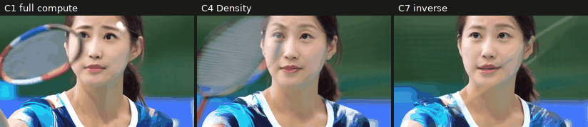
  <br><sub>One prompt and seed: full compute (40 dense steps), Density at half the budget, and the inverse check that
  denies the face any full steps. All Wan2.1-T2V-1.3B output.</sub>
</p>

The code in this repository is written with Claude, Anthropic's AI assistant, under my direction.

## In short

- **The idea.** HSA ("Not All Tokens Need 40 Steps", Chu and Patel, 2026) gives a small group of video tokens all 40
  denoising steps and the rest fewer, chosen by a *need score*: how much each token's predicted velocity is still
  changing over the first five steps. **Density** reweights that choice toward the region of interest, so faces, hands,
  contact and the held object get more of the full steps for the same budget.
- **What I built:**
  - a pre-registered protocol;
  - a Wan2.1-T2V-1.3B sampler that matches diffusers, with HSA's token skipping built on it and checked bit for bit;
  - a segmentation pipeline that turns faces and hand-object contact into token-level regions;
  - lossless scoring (masked LPIPS and five VBench quality dimensions);
  - a resumable GPU job runner;
  - an analysis frozen by code hash before any data existed.
- **Engineering.** Every GPU session starts with **bit-for-bit** canaries against registered outputs: generation,
  metrics, masks and video encoding. They have held across four H100 hosts (two drivers) and three RTX PRO 6000 slice
  hosts.
- **Result so far** (a 12-prompt pilot, not the confirmatory run):
  - HSA reproduces: at half the budget, its error is 58% of naive step-halving's.
  - Density raised the region's share of compute from 37% to 47%, but the region's fidelity barely moved. Its median
    per-prompt improvement, the protocol's primary statistic, is 0.6%; GO needs 10%. On the ratio of the two medians
    it is 0.8% worse.
  - An exploratory inverse kept every full step out of the region (its share fell to 28%). The region got only
    slightly worse: 4.5% on the ratio of medians, the statistic this check registered, and 0.5% on the median
    per-prompt change.
  - **So far, moving steps into or out of the region changes its fidelity very little at this budget.** The 72-prompt
    main run is on hold pending a go/no-go decision.
- **GPU spend for the whole project so far: $21.23.**

## How it works

Wan2.1 denoises a video as 32,760 latent tokens over 40 steps. HSA-50 spends about half that compute. Every token runs
the first five steps, which also give each token its need score g, and the last four. In between, a full-step group of
5,242 tokens (16%) runs every step and the rest run every fourth step: 16 of the 40 in all. The conditions differ only
in **which** tokens make the full-step group:

<picture>
  <source media="(prefers-color-scheme: dark)" srcset="docs/images/allocation_dark.png">
  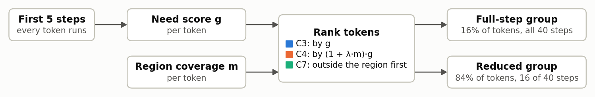
</picture>

| Condition | What it is |
| --- | --- |
| C1 | Full compute: 40 dense steps. The reference every other condition is measured against. |
| C2 | 20 dense steps for every token: the naive way to spend half the budget. |
| C3 | HSA-50: half the budget, need-ranked. The baseline Density has to beat. |
| C4 | **Density**: HSA-50 ranked by (1 + λ·m)·g, so region tokens move up. |
| C7 | Exploratory inverse: HSA-50 with region tokens (m ≥ 0.1) never in the full-step group. |

The primary measure is **masked LPIPS**: the perceptual difference from C1, averaged inside the region dilated by 8
pixels. Seven guardrails check that nothing else gets worse: full-frame and outside-region LPIPS, and VBench's subject
and background consistency, motion smoothness, aesthetic and imaging quality.

## The pipeline

<picture>
  <source media="(prefers-color-scheme: dark)" srcset="docs/images/pipeline_dark.png">
  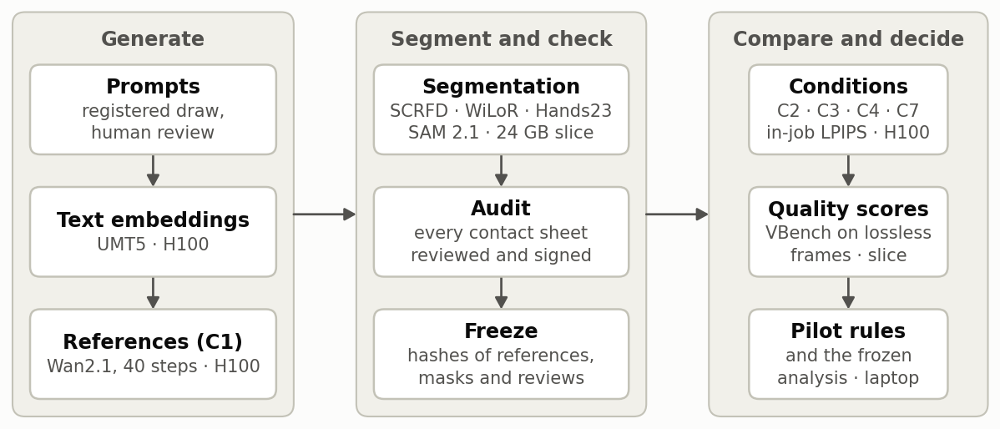
</picture>

Generation runs on an H100; segmentation and quality scoring run on a 24 GB GPU slice. The laptop runs everything that
decides: the pilot rules, the analysis, and end-to-end dry runs with tiny random models.

## Segmentation: from detections to token regions

Each reference video is segmented into the region its prompt is about: the face, or the hands together with the object
they hold and the contact between them.

- SCRFD finds faces and WiLoR finds hands on every frame.
- Hands23 confirms the hands, and finds the objects they hold and when they touch.
- SAM 2.1 tracks each one through all 81 frames. Contact is where a hand and its object meet, on the frames where
  contact is confirmed. (Mask R-CNN finds whole people, for the main run's full-body prompts.)
- Each latent token then gets a coverage m between 0 and 1. Tokens with m ≥ 0.1 count as the region.

Every sheet below was reviewed and signed before any reduced-compute video existed.

<p align="center">
  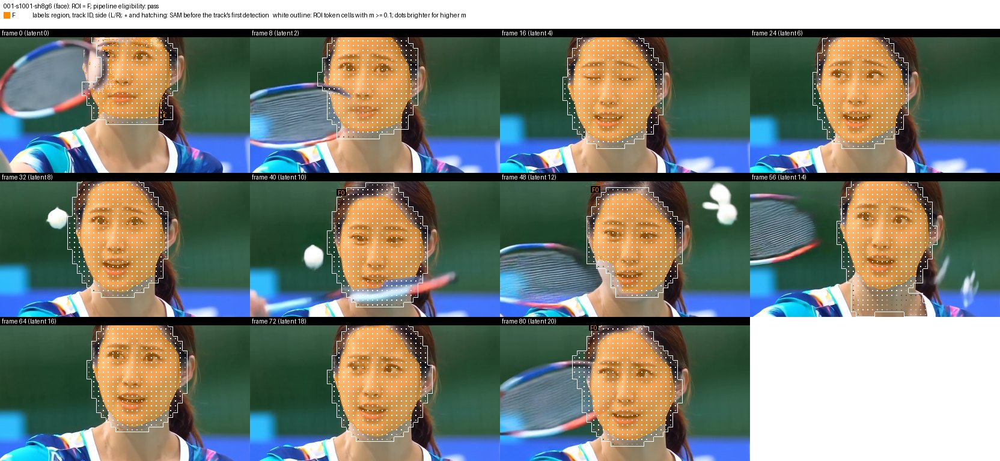
  <br><sub><b>Face prompt.</b> Orange: the face region, on every 8th frame. White outline: the latent token cells it
  covers (m ≥ 0.1), with a dot in each, brighter for higher coverage.</sub>
</p>

<p align="center">
  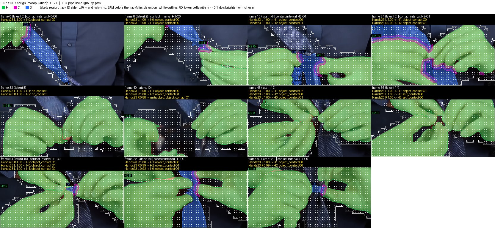
  <br><sub><b>Hands prompt (tying a tie).</b> Green: hands. Magenta: contact. Blue: the held object. Each frame lists
  Hands23's hands, their contact state, and whether the frame lies in a confirmed contact interval.</sub>
</p>

<details>
<summary>One more: strumming a guitar</summary>

<p align="center">
  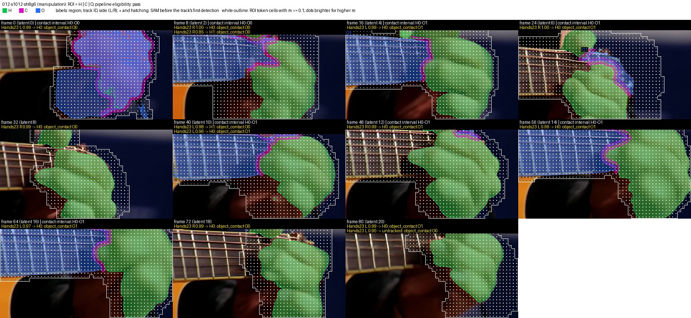
</p>
</details>

## Results

### The pilot

Twelve held-out prompts (6 faces, 6 hands), one seed each, ran through every pilot rule. None stopped the study.

- **Setting.** Shift 8 / guidance 6, picked over shift 5 / guidance 5 by mean face and hand detection coverage (0.9959
  against 0.9938).
- **HSA reproduces.** At the same 50% budget, HSA's full-frame error is 58% of the naive baseline's. The check had to
  come in under 70%.

<picture>
  <source media="(prefers-color-scheme: dark)" srcset="docs/images/c2_check_dark.png">
  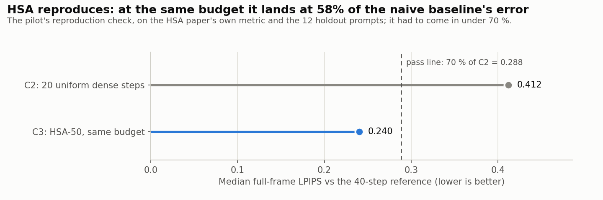
</picture>

- **Choosing λ.** All three candidates stayed well inside the outside-region guardrail. The registered rule then took
  the lowest median masked LPIPS, λ = 10, but the three are within 0.001 of each other.

| λ | Mean outside-region degradation (C4 − C3) | Median masked LPIPS | Qualifies (< 0.01) |
|---|---|---|---|
| 1 | +0.0021 | 0.2708 | yes |
| 3 | +0.0020 | 0.2714 | yes |
| 10 | +0.0019 | 0.2705 | yes |

- **Every holdout prompt passed** segmentation and review (12 of 12). Density changed the allocation on every prompt
  (no no-ops).

### Does the region's compute matter?

Density moves compute into the region. C7, an exploratory check registered before it ran, keeps every full step out of
it. With the budget fixed, the region's share of the compute spans 28% (C7), 37% (C3) and 47% (C4). Its fidelity
barely follows.

<picture>
  <source media="(prefers-color-scheme: dark)" srcset="docs/images/dose_response_dark.png">
  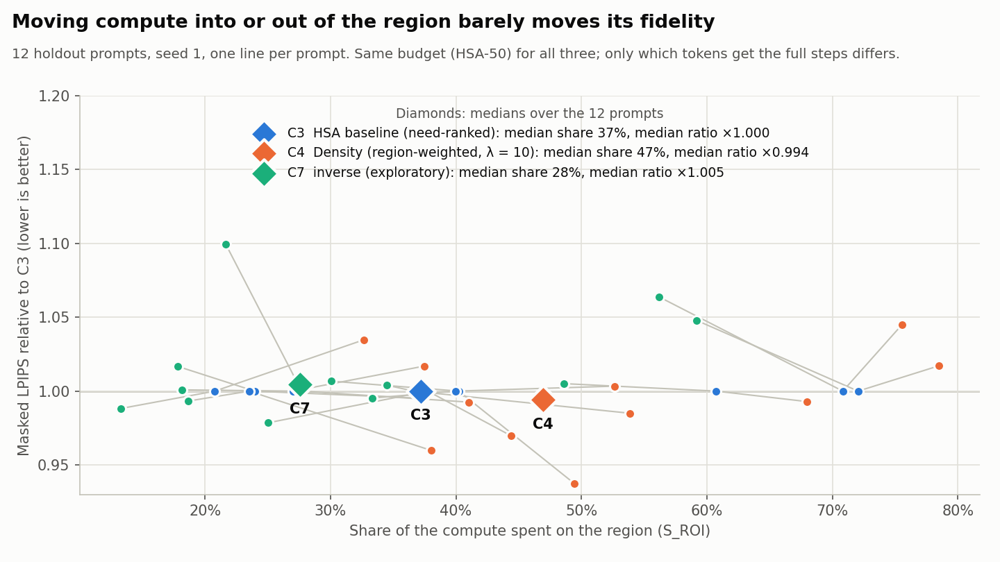
</picture>

<picture>
  <source media="(prefers-color-scheme: dark)" srcset="docs/images/per_prompt_dark.png">
  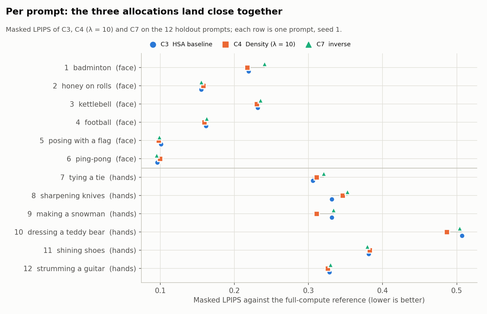
</picture>

In the table, LPIPS is the masked LPIPS against C1 (lower is better), C4 is at λ = 10, and Share is the region's share
of the compute.

| Prompt | LPIPS C3 | LPIPS C4 | LPIPS C7 | C7 / C3 | Share C3 | Share C4 | Share C7 |
|---|---|---|---|---|---|---|---|
| 1 badminton | 0.2190 | 0.2173 | 0.2407 | 1.099 | 28% | 41% | 22% |
| 2 honey on rolls | 0.1551 | 0.1578 | 0.1553 | 1.001 | 27% | 37% | 18% |
| 3 kettlebell | 0.2313 | 0.2302 | 0.2352 | 1.017 | 24% | 37% | 18% |
| 4 football | 0.1617 | 0.1592 | 0.1623 | 1.004 | 37% | 54% | 34% |
| 5 posing with a flag | 0.1009 | 0.0979 | 0.0988 | 0.979 | 38% | 44% | 25% |
| 6 ping-pong | 0.0960 | 0.0993 | 0.0948 | 0.988 | 21% | 33% | 13% |
| 7 tying a tie | 0.3056 | 0.3108 | 0.3202 | 1.048 | 72% | 79% | 59% |
| 8 sharpening knives | 0.3312 | 0.3461 | 0.3523 | 1.064 | 71% | 76% | 56% |
| 9 making a snowman | 0.3316 | 0.3108 | 0.3338 | 1.007 | 40% | 49% | 30% |
| 10 dressing a teddy bear | 0.5070 | 0.4867 | 0.5036 | 0.993 | 24% | 38% | 19% |
| 11 shining shoes | 0.3810 | 0.3823 | 0.3792 | 0.995 | 40% | 53% | 33% |
| 12 strumming a guitar | 0.3280 | 0.3257 | 0.3297 | 1.005 | 61% | 68% | 49% |
| **median** | **0.2684** | **0.2705** | **0.2805** | | **37%** | **47%** | **28%** |

The median row is each column's own median, so its ratios are not the medians of the per-prompt ratios.

- **Density versus HSA.** At λ = 10, C4's masked LPIPS improves on C3's by a median of 0.6% per prompt (the protocol's
  primary statistic; GO needs at least 10%), and is better on 7 of 12 prompts. On the ratio of the two medians, C4 is
  0.8% worse.
  - Nothing else moved much. C4's mean full-frame and outside-region LPIPS rose by only 0.0015 and 0.0019, against a
    limit of 0.01, and its five VBench quality scores were, on average, no lower than C3's.
- **Taking the full steps away.** C7 is worse than C3 on 8 of 12 prompts, but by more than 2% only on three of them
  (5%, 6% and 10%).
  - The check's registered statistic, the ratio of the two medians, is 1.045: in the band where its pre-registered
    rule calls for outside input.
  - The median of the per-prompt ratios is 1.005.
  - Tokens covered only lightly (0 < m < 0.1) count as outside the region: 38 to 241 of them per prompt reached C7's
    full-step group of 5,242.
- **Outside the region**, C7 stays close to C3 as well: its mean outside-region LPIPS is higher by 0.0013.

These are 12 prompts with one seed. The pilot was designed to set up the main run, not to test the hypothesis.

### What the videos look like

<p align="center">
  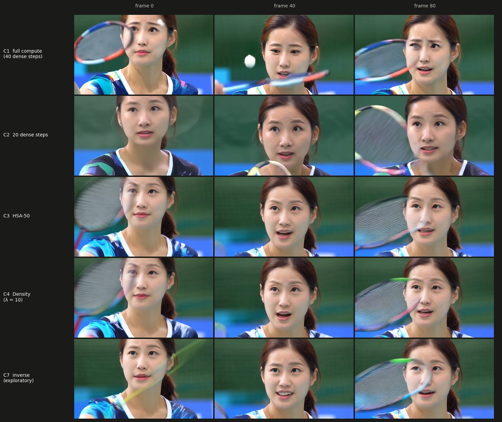
  <br><sub>A face prompt at frames 0, 40 and 80. Same seed, same starting noise; only the step allocation changes.</sub>
</p>

<p align="center">
  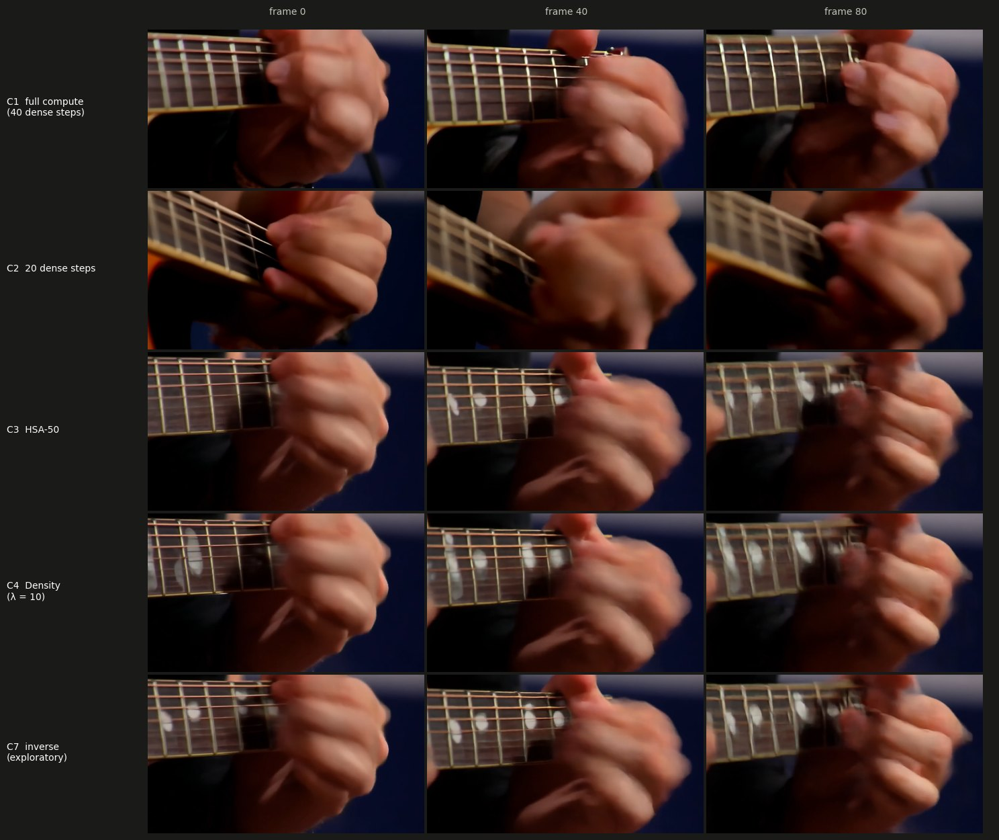
  <br><sub>A hands prompt (strumming a guitar), the same way.</sub>
</p>

## Rigor and reproducibility

- **Pre-registered.** The protocol fixed every hypothesis, metric, threshold, seed and decision rule before any
  experimental data.
  - Changes since are dated amendments.
  - The primary analysis is frozen by code hash, and refuses to run if the analysis code has changed.
  - Exploratory checks are registered as exploratory before they run.
- **Bit-for-bit canaries** run at the start of every GPU session, and any difference stops the session:
  - **generation:** a fixed video's latents and frames;
  - **metrics:** LPIPS, PSNR and SSIM, VBench quality, and the detectors;
  - **segmentation:** every mask model on fixed frames;
  - **encoding:** a fixed clip, encoded to MP4 and decoded, by the hash of its frames.

  They reproduced across four H100 hosts on two drivers and three slice hosts. The encoding canary also held between an
  arm64 laptop and the x86 GPU servers.
- **Determinism, measured rather than assumed:**
  - Flash attention is pinned. PyTorch's default on the H100, cuDNN attention, was bitwise within a process but not
    across processes. Flash costs 22–27% more time.
  - Deterministic algorithms run in strict mode: an operation without a deterministic implementation stops the job.
  - Starting noise is generated once on CPU, saved, and loaded by hash, because x86 and ARM give different noise for
    the same seed.
  - Mask R-CNN and Hands23 call torchvision's ROIAlign kernel directly. In deterministic mode torchvision would swap
    in a slow fallback; the kernel is 100–250× faster, with bitwise repeats.
- **Scored before compression.** Every reduced-compute video keeps a lossless FFV1 copy, verified bit for bit, and all
  scores come from it. The MP4s are for watching.
- **A resumable runner.** Atomic job records, a manifest you can only append to, per-prompt GPU and image pinning, a
  volume guard, and end-to-end dry runs on a laptop. 305 tests.

## Status

- **Done:**
  - Milestones 1–5: an Euler sampler matching diffusers, HSA mechanics, allocation rules, the segmentation pipeline,
    and metrics with the runner and frozen analysis.
  - The GPU smoke test.
  - The pilot.
  - The exploratory inverse check.
- **Next:** a go/no-go decision. The registered main run is 72 primary prompts with two seeds each, about $65 of GPU
  time at the pilot's measured job times. The alternative is a different lever.

## Repository layout

| Path | What is there |
| --- | --- |
| `src/density/` | The sampler, HSA, allocation rules, conditions, segmentation (`masks/`), metrics (`metrics/`), the job runner (`run/`), pilot rules, the frozen analysis, and the exploratory check |
| `configs/` | Registered settings: pinned prompt sources, the drafted prompt set, canary registrations, the analysis freeze |
| `scripts/pod/` | Pod setup, rsync transfers and session launchers |
| `scripts/readme_figures.py` | Makes every figure and table in this README from the pilot's run records, which stay outside the repository |
| `tests/` | 305 tests |
| `results/checks/` | Reports of the milestone checks and the GPU smoke test |
| `third_party/` | Vendored VBench, IQA-PyTorch, CLIP, DINO and Hands23 code, each with its license and a recorded diff |
| `docs/` | The protocol, the engineering notes (`engineering.md`) and the figures |

## Running it

```bash
uv sync
uv run pytest
```

Tests that need downloaded weights, the pinned prompt files, the stock clips or Apple's MPS skip themselves: on a fresh
clone on a Mac, 288 pass and 17 skip. Weights are not included. The pinned Wan2.1 revision, the segmentation and
metric weights, and the GPU setup are in [`docs/engineering.md`](docs/engineering.md).

## Licenses and attribution

- **This repository's own code** is under the MIT license ([`LICENSE`](LICENSE)). Everything in `third_party/` keeps
  its own license, listed below.
- **Method:** HSA, "Not All Tokens Need 40 Steps" (Chu and Patel, 2026), is the step-allocation mechanism this study
  builds on. Wan2.1 (Wan Team, 2025) is the generator; its weights are not included.
- **Prompts** are rewritten from:
  - VBench (Huang et al., CVPR 2024) and VBench-2.0 (Zheng, Huang et al., 2025), both Apache-2.0;
  - T2V-CompBench (Sun et al., CVPR 2025). It has no license, so only rewritten prompts are published, with this
    citation;
  - Kinetics-400 class names (Kay et al., 2017; CC BY 4.0).
- **Vendored code** (`third_party/`):
  - VBench v0.1.5 (Apache-2.0), including AMT (CC BY-NC 4.0);
  - IQA-PyTorch (CC BY-NC-SA 4.0);
  - OpenAI CLIP (MIT);
  - DINO (Apache-2.0);
  - the Hands23 detector (Cheng et al., NeurIPS 2023; MIT).
- **Models used at run time** (weights not included):
  - SAM 2.1 (Apache-2.0);
  - InsightFace SCRFD and ArcFace (non-commercial research only);
  - WiLoR (CC BY-NC-ND 4.0, loaded through Ultralytics, AGPL-3.0);
  - Hands23 (its weights' terms are not stated);
  - Mask R-CNN from the Detectron2 model zoo (CC BY-SA 3.0);
  - LPIPS (BSD-2-Clause);
  - DINO (Apache-2.0), CLIP (MIT) and the LAION aesthetic head (MIT), inside VBench's dimensions;
  - MUSIQ and AMT-S (CC BY-NC-SA 4.0).

  Several of these are non-commercial, so the project as a whole is for research use.
- **Images** in this README are Wan2.1 outputs from the pilot.
